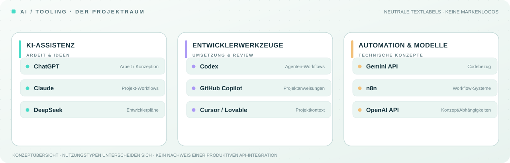
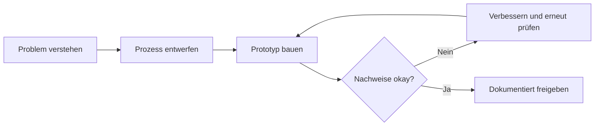

<div align="center">

**Deutsch** · [English](docs/README.en.md)

<picture>
  <source media="(prefers-color-scheme: dark)" srcset="assets/profile-hero-dark.svg" />
  
</picture>

### Hey, ich bin rootkid-code. 👋

# Ideen werden Systeme. Vibes werden überprüft.

**AI & Automation · Product Engineering · UI/UX · Creative Development**

Ich baue, erkunde und verbessere digitale Produkte: vom ersten Workflow über verständliche Benutzeroberflächen bis zu überprüfbaren technischen Abläufen.

`⚡ VIBE CODING: ON` · `🧪 REALITY CHECK: REQUIRED` · `🛡️ HUMAN REVIEW: ALWAYS`

[**Projekte**](#03--öffentliche-projekte) · [**KI-Werkbank**](#04--ki-werkbank) · [**Tech-Stack**](#05--technologie-landkarte) · [**Code-Rhythmus**](#07--code-rhythmus) · [**Mehr erfahren**](#09--mehr-als-eine-readme)

</div>

---

## 01 / Warum ich baue

**Software ist dann spannend, wenn sie ein echtes Problem verständlicher oder einfacher macht.**

Meine Projekte verbinden **KI-gestützte Prozesse, Automatisierung, Datenflüsse, visuelles Design und konkrete Anwendungen**. Ich arbeite gern schnell an ersten Ideen – und genauso gern daran, was danach wirklich zählt: Fehlerfälle, Berechtigungen, verständliche Bedienung und belastbare Ergebnisse.

Das Leitmotiv dahinter:

> **Mit Neugier starten. Mit System bauen. Mit Belegen veröffentlichen.**

Das hier ist kein Lebenslauf und keine Liste erfundener „Experten-Level“, sondern eine **kuratierte Werkbank** mit Einblicken in die Art von Software, die ich entwickle.

## 02 / Mission Control

<picture>
  <source media="(prefers-color-scheme: dark)" srcset="assets/mission-control-dark.svg" />
  
</picture>

<sub>Ein eigens gestaltetes Statuspanel, **keine Live-Telemetrie** und keine gemessenen Skill-Balken. [So lässt sich der echte GitHub-Status einstellen](docs/PROFILE_SETTINGS.md).</sub>

## 03 / Öffentliche Projekte

<table>
<tr>
<td width="50%" valign="top">
<div align="center">
  <picture>
    <source media="(prefers-color-scheme: dark)" srcset="https://raw.githubusercontent.com/rootkid-code/showcase-studio-releases/main/assets/brand/showcase-portfolio-dark.svg" />
    
  </picture>
  <h3><a href="https://github.com/rootkid-code/showcase-studio-releases">Showcase Studio</a></h3>
  <strong>Automationen verstehen. Sicher präsentieren.</strong>
</div>
<p>Lokales Präsentationsstudio für n8n-Workflows: Visualisierung, sieben Stile, Privacy-Review und Offline-Exporte. Die öffentliche Beta ist ein Testrelease, kein Stable-Produkt.</p>
<p><code>n8n</code> <code>Python</code> <code>FastAPI</code> <code>Workflow UX</code></p>
<p><strong>Status:</strong> <a href="https://github.com/rootkid-code/showcase-studio-releases/releases/tag/v1.0.0-beta.4"><strong>v1.0.0-beta.4 · öffentliche Testversion</strong></a> · Make-/Zapier-Import geplant, derzeit nur Design-Looks</p>
<p><a href="https://github.com/rootkid-code/showcase-studio-releases"><strong>Projekt & Dokumentation ansehen →</strong></a></p>
</td>
<td width="50%" valign="top">
<div align="center">
  
  <h3><a href="https://github.com/rootkid-code/tresor-releases">Tresor / Beta Lab</a></h3>
  <strong>Desktop-Entwicklung als Testlabor.</strong>
</div>
<p>Experimentelles Windows-Projekt zu lokalen Anwendungen, Packaging, Updates, Sicherheitsgrenzen und nachvollziehbaren Releases.</p>
<p><code>Rust</code> <code>Tauri</code> <code>React</code> <code>TypeScript</code></p>
<p><strong>Status: experimentelle Beta-Pakete.</strong> Keine echten, sensiblen oder wichtigen Dateien verwenden.</p>
<p><a href="https://github.com/rootkid-code/tresor-releases"><strong>Beta-Lab erkunden →</strong></a></p>
</td>
</tr>
</table>

<sub>Beide Projektgrafiken haben bewusst dasselbe Seitenverhältnis (1440 × 600). Es sind originale Konzept-Visuals, keine Screenshots oder Prüfnachweise.</sub>

## 04 / KI-Werkbank

KI ist für mich **Werkzeug, Sparringspartner und technischer Baustein** – je nach Aufgabe. Die entscheidende Frage ist nicht, wie viele Modelle man auflistet, sondern **wo sie sinnvoll helfen und wie ihre Ergebnisse geprüft werden**.

<picture>
  <source media="(prefers-color-scheme: dark)" srcset="assets/ai-workbench-dark.svg" />
  
</picture>

| Bereich | Beispiele aus Projektmaterial und Entwicklungsarbeit |
|:--|:--|
| **KI-Assistenten & Modelle** | ChatGPT (OpenAI), Claude (Anthropic), DeepSeek; je nach Kontext für Konzeption, Lösungsvarianten, Entwicklungsaufgaben und Review |
| **Coding & Prototyping** | Codex, GitHub Copilot, Cursor, Lovable; dokumentierte Entwicklungs- und Agentenworkflows |
| **Technische Integration** | Gemini API, n8n, strukturierte KI-Ausgaben, Modell-/Prompt-Konfiguration, Validierung und Fehlerbehandlung |
| **Kontrollmechanismen** | Schema-Prüfung, Rechtebegrenzung, Human-in-the-Loop, negative Tests, Logging ohne unnötige Rohdaten |

**Wichtig:** Die Namen sind beschreibende Referenzen. **ChatGPT/Claude** tauchen unter anderem in Projektmetadaten auf, **DeepSeek** in Entwicklerunterlagen, **Gemini** in konkretem Client-/API-Code. Das ist **keine** Aussage, dass jeder Anbieter in jeder Anwendung produktiv integriert wurde.

[**KI-Toolbox mit Einsatzkontext und Nachweisstufen**](docs/AI_TOOLBOX.md) · [**Sicherer Workflow-Ansatz**](docs/WORKFLOW_PLAYBOOK.md)

## 05 / Technologie-Landkarte

Keine riesige Herstellerlogo-Wand. Stattdessen eine ruhige, eigens gestaltete **Übersicht nach Aufgaben** – damit Besucher sofort erkennen, woran ich technisch arbeite.

<picture>
  <source media="(prefers-color-scheme: dark)" srcset="assets/stack-atlas-dark.svg" />
  
</picture>

| Disziplin | Werkzeuge und Erfahrungen im Projektkontext |
|:--|:--|
| **Interfaces & Product UX** | React, TypeScript, JavaScript, HTML/CSS, Vite, Astro, Tailwind CSS, responsive UI, Accessibility |
| **Backends & Daten** | Python, FastAPI, Node.js, API-Verträge, PostgreSQL, Supabase, Authentifizierung, Datenmodelle |
| **Automationssysteme** | n8n, Webhooks, LLMs, strukturierte Datenextraktion, Mensch-in-der-Schleife, nachvollziehbare Übergaben |
| **Qualität & Delivery** | Git/GitHub, Branches, PR-Reviews, Tests, Vitest, Playwright, Browser- und Windows-Prüfkonzepte |
| **Kreative Technik** | Blender, Three.js, WebGL, 3D-Szenen, Kameraabläufe, Performance-Optimierung |
| **Desktop-Experimente** | Rust, Tauri, lokale Datenabläufe, Paketierung und Update-Strategien |

Die Zuordnung orientiert sich an **echten Quellständen und Projektunterlagen**. Sie ist keine Zertifizierung und kein Beleg für tiefgehende Expertise in jedem genannten Werkzeug.

[**Ausführlicher Stack mit Projektherkunft**](docs/TECH_STACK.md) · [**Warum ich auf fremde Logos verzichte**](docs/BRAND_POLICY.md)

## 06 / Was in der Werkstatt entsteht

Ein großer Teil der Entwicklungsarbeit ist bewusst noch **privat**. Hier geht es um den *Problemraum und Ansatz* – nicht um die öffentliche Bereitstellung von Quellcode oder Kundendaten.

| Projekt | Die Idee dahinter | Themen |
|:--|:--|:--|
| **🚲 Kettenwerk** | Vom Fahrrad-Finder und der KI-gestützten Anfragevorbereitung zu strukturierten Werkstattprozessen | React · Supabase · Gemini · Rollen & Freigaben |
| **🧠 KI-Atlas** | KI-Wissen durch verknüpfte Begriffe, Lernpfade und interaktive Visualisierungen verständlicher machen | Astro · Wissensgraph · Lern-UX |
| **🎬 SYNTHESIS** | Filmische, monumentale 3D-Erlebnisse vom Blender-Set in den Browser übersetzen | Blender · Three.js · WebGL |
| **🧩 Career Workspace** | Bewerbungsabläufe mit überprüfbaren Fakten vorbereiten statt KI-Behauptungen zu erzeugen | TypeScript · Supabase · Evidence-first |
| **🛠️ ProjectPilot** | Komplexere GitHub- und Entwicklungsworkflows einfacher koordinieren und nachvollziehbar prüfen | GitHub · Orchestrierung · QA |
| **🧱 Weitere Prototypen** | Web-Services, Prozessoberflächen, Automationsideen und digitale Arbeitsräume | UX · Daten · Integrationen |

<details>
<summary><strong>Die Projektideen mit Problem, Architektur und Reifegrad genauer ansehen</strong></summary>

Die einzelnen Projekte haben unterschiedliche Entwicklungsstände. Ein privates Repository ist **keine** öffentliche Demo, und ein vorhandenes Modul ist **kein** Nachweis für produktiven Betrieb.

[**Vertiefte Projektgeschichten**](docs/PROJECT_STORIES.md) · [**Projektkarte und Veröffentlichungsregeln**](docs/PROJECTS.md)

</details>

## 07 / Code-Rhythmus

<picture>
  <source media="(prefers-color-scheme: dark)" srcset="assets/build-loop-dark.svg" />
  
</picture>

**Nicht jede Idee braucht KI. Nicht jeder Prototyp braucht eine Datenbank. Und nicht jeder grüne Build ist bereit für ein Release.**



Das ist mein Arbeitsprinzip – keine Behauptung, dass jedes bestehende Projekt schon alle Qualitätsschritte bestanden hat. [Mehr über die Entwicklungsprinzipien](docs/BUILD_PRINCIPLES.md).

## 08 / Vibe-Coding-Labor

<details>
<summary><strong>⚡ Terminal öffnen – Disclaimer: Die Vibes kompilieren nicht von allein</strong></summary>

```text
rootkid@lab:~$ vibe --intensity=11

  [██████████] NEUGIER             ONLINE
  [██████████] IDEEN               GELADEN
  [██████████] PROTOTYPEN          AKTIV

rootkid@lab:~$ ship --skip-review

  ✖ FEHLER: confidence != evidence
  → Kein Review, keine Freigabe.
  → Kein Datenschutzcheck? Auch nicht.
  → Der erste Build ist keine Produktgarantie.

rootkid@lab:~$ ship --with-receipts

  ◇ Struktur geprüft
  ◇ Tests müssen belegt werden
  ◇ Dokumentation wird mitgenommen

  Stimmung: fantastisch. Release-Gate: unbeeindruckt. 🧪
```

*Humorvolle, frei erfundene Terminalszene – keine ausgeführte Prüfung und kein tatsächliches Testergebnis.*

</details>

## 09 / Mehr als eine README

Damit das Profil oben **übersichtlich** bleibt, liegen Details in eigenständigen, dauerhaft gepflegten Dokumenten.

| Einblick | Darum geht es |
|:--|:--|
| [**KI-Toolbox**](docs/AI_TOOLBOX.md) | ChatGPT, Claude, DeepSeek, Codex, Copilot, Gemini und weitere Tools: Einordnung und Nachweisstufen |
| [**Tech-Stack**](docs/TECH_STACK.md) | Technologien nach Systemebene und konkrete Projektbezüge |
| [**Projektgeschichten**](docs/PROJECT_STORIES.md) | Problem → Idee → Implementierung → Grenzen |
| [**Workflow-Playbook**](docs/WORKFLOW_PLAYBOOK.md) | Validierung, menschliche Freigaben, Fehlerbehandlung und Datenschutz |
| [**Code-Rhythmus**](docs/BUILD_PRINCIPLES.md) | Die Arbeitsprinzipien hinter den Prototypen |
| [**Brand Policy**](docs/BRAND_POLICY.md) | Warum Herstellerlogos bewusst nicht als Dekoration verwendet werden |
| [**Profil-Status & Bio**](docs/PROFILE_SETTINGS.md) | GitHub-Status, Sichtbarkeit, E-Mail-Privatsphäre |
| [**Designsystem**](docs/BRAND_GUIDE.md) | Farben, SVGs, Header und künftige Logo-Integration |

### Aktuell im Fokus

**Besser machen, was schon entsteht.** Verständlichere Oberflächen, robustere Automationen, nachvollziehbare Tests und frei nutzbare Community-Experimente.

**Verkauf, Preise und Pro-Vermarktung sind weiterhin auf HOLD.** Showcase Studio besitzt inzwischen eine öffentliche **Beta 4 zum Testen**; die Produktreife bleibt von Windows-, Security- und Privacy-Abnahmen abhängig. Das Profil ist ein Projektportfolio, kein Shop und keine behauptete offizielle Partnerschaft mit den genannten Anbietern.

---

<div align="center">

### rootkid / code

*Vibe-code the idea. Engineer the edges. Show the evidence.*

[**Öffentliche Repositories**](https://github.com/rootkid-code?tab=repositories) · [**English**](docs/README.en.md) · [**Technische Projekte**](docs/PROJECTS.md) · [**Rechte**](NOTICE.md)

<sub>Eigenes Profil-Design · Keine fremden Markenlogos im Stack · Keine erfundenen Skillwerte · Kein Besuchertracking</sub>

</div>
