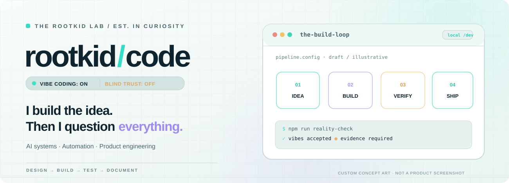
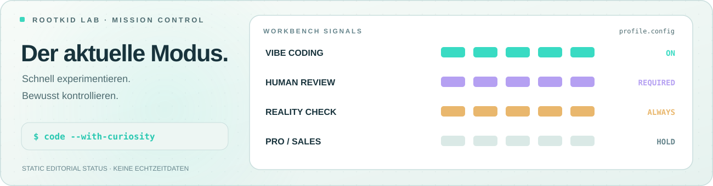
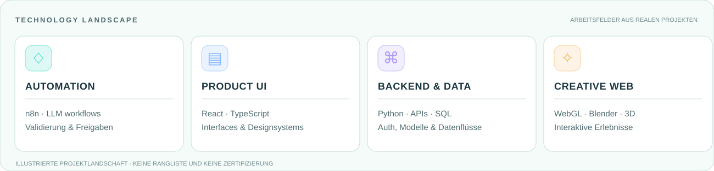
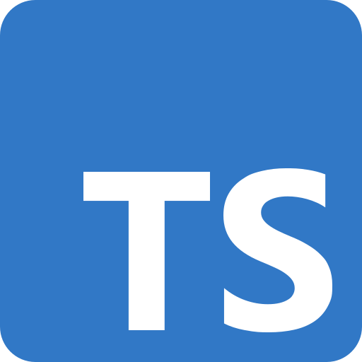
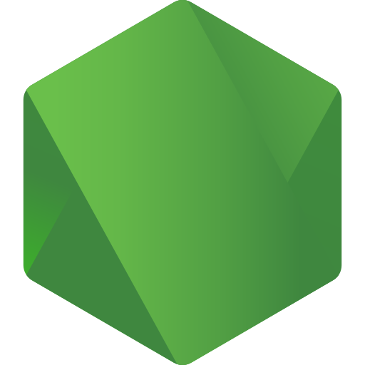
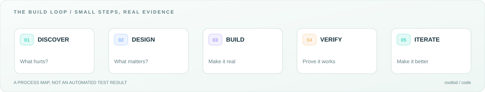

<div align="center">

**Deutsch** · [English](docs/README.en.md)

<picture>
  <source media="(prefers-color-scheme: dark)" srcset="assets/profile-hero-dark.svg" />
  
</picture>

### Hey, ich bin rootkid-code. 👋

# Ideen bauen. Systeme verstehen. Dinge besser machen.

**KI · Automatisierung · Product Engineering · UI/UX · Creative Web**

Aus einem Gedanken wird ein Prototyp. Aus einem Prototyp wird – mit etwas Hartnäckigkeit, guten Tests und sauberem Design – irgendwann etwas wirklich Nützliches.

`⚡ VIBE CODING: AN` &nbsp; `🧪 REALITY CHECK: PFLICHT` &nbsp; `🚫 BLINDES VERTRAUEN: AUS`

[**Projekte**](#ausgewählte-projekte) · [**Tech-Stack**](#mein-tech-stack) · [**Code-Rhythmus**](#mein-code-rhythmus) · [**Werkbank**](#hinter-den-kulissen) · [**Projektübersicht**](docs/PROJECTS.md)

</div>

---

## 01 / Wer hinter dem Code steckt

**Nicht das nächste Framework ist mein Ausgangspunkt, sondern ein Problem, das sich besser lösen lässt.**

Ich beschäftige mich mit **KI-gestützten Workflows, benutzbaren Anwendungen, Automatisierung und nachvollziehbaren Prozessen**. Dabei verbindet meine Arbeit das Denken in Abläufen mit Produktdesign und der praktischen technischen Umsetzung.

Ich mag schnelle Experimente. Noch spannender finde ich die Fragen danach: **Was passiert im Fehlerfall? Versteht ein anderer Mensch die Oberfläche? Welche Daten dürfen wohin? Und funktioniert es außerhalb einer Demo wirklich?**

> **Mit Neugier entwickeln. Mit Belegen veröffentlichen.**

## 02 / Mission Control

<picture>
  <source media="(prefers-color-scheme: dark)" srcset="assets/mission-control-dark.svg" />
  
</picture>

<sub>Ein augenzwinkerndes, fest gestaltetes Werkbank-Panel – **keine** automatisch gemessene Aktivität, kein Test-PASS und keine Aussage über Live-Verfügbarkeit. Den nativen GitHub-Status kannst du [separat ansehen](docs/PROFILE_SETTINGS.md).</sub>

## 03 / Ausgewählte Projekte

<table>
<tr>
<td width="50%" valign="top">
  <div align="center">
    <a href="https://github.com/rootkid-code/showcase-studio-releases">
      
    </a>
    <h3>SHOWCASE STUDIO</h3>
    <strong>Komplexe Automationen. Klar erzählt.</strong>
  </div>
  <p>Ein lokaler Präsentations- und Dokumentations-Workspace für <strong>n8n-Workflows</strong>. Strukturen sichtbar machen, Zusammenhänge erklären und Inhalte vor dem Teilen prüfen.</p>
  <p><code>n8n</code> <code>Python</code> <code>FastAPI</code> <code>Workflow UX</code></p>
  <p><strong>Öffentlicher Stand:</strong> Produktinformationen und Dokumentation. <strong>Noch kein öffentlicher App-Download.</strong></p>
  <p><a href="https://github.com/rootkid-code/showcase-studio-releases"><strong>Zum Projekt →</strong></a></p>
</td>
<td width="50%" valign="top">
  <div align="center">
    <a href="https://github.com/rootkid-code/tresor-releases">
      
    </a>
    <h3>TRESOR / BETA LAB</h3>
    <strong>Desktop-Experimente mit bewusst engen Grenzen.</strong>
  </div>
  <p>Ein experimentelles Windows-Projekt rund um lokale Software, Anwendungspakete und Entwicklungsprozesse mit <strong>Tauri, Rust und TypeScript</strong>.</p>
  <p><code>Desktop</code> <code>Rust</code> <code>Tauri</code> <code>Release Engineering</code></p>
  <p><strong>Öffentlicher Stand:</strong> Experimentelle Betas. <strong>Nur für künstliche Testdaten, nicht für sensible oder wichtige Dateien.</strong></p>
  <p><a href="https://github.com/rootkid-code/tresor-releases"><strong>Zum Beta-Lab →</strong></a></p>
</td>
</tr>
</table>

Die Projektlinks führen ausschließlich zu **tatsächlich öffentlichen** Repositories. Private Entwicklungsstände werden nicht als öffentliche Downloads ausgegeben.

## 04 / Mein Tech-Stack

<picture>
  <source media="(prefers-color-scheme: dark)" srcset="assets/tech-landscape-dark.svg" />
  
</picture>

<div align="center">

**Ein Ausschnitt aus den Technologien, mit denen ich in Projekten arbeite**

<p>
   &nbsp;&nbsp;
   &nbsp;&nbsp;
   &nbsp;&nbsp;
   &nbsp;&nbsp;
   &nbsp;&nbsp;
   &nbsp;&nbsp;
   &nbsp;&nbsp;
  
</p>

<sub>Selbst gehostete, aus dem eigenen Projektbestand übernommene Technologie-SVGs. Marken gehören ihren jeweiligen Inhabern; keine Partnerschaft oder Zertifizierung.</sub>

</div>

| Schwerpunkt | Werkzeuge und Methoden aus dem Projektbestand |
|:--|:--|
| **AI & Automation** | n8n, LLM-Integration, Gemini, strukturierte Ausgaben, Validierung, Human-in-the-Loop |
| **Frontend & UX** | React, TypeScript, JavaScript, HTML/CSS, Vite, Astro, responsive Oberflächen, Designsysteme |
| **Backend & Daten** | Python, FastAPI, Node.js, PostgreSQL, Supabase, Auth, APIs |
| **Tests & Delivery** | Git/GitHub, Pull Requests, Playwright, Vitest, dokumentierte QA- und Release-Gates |
| **Creative Development** | Three.js/WebGL, Blender, interaktive 3D-Prototypen und visuelles Storytelling |

**Keine Skill-Prozentbalken:** Die Liste beschreibt nachweisbar verwendete oder in Projekten erkundete Technologien, **keine** Zertifizierungen und keine erfundene Expertenbewertung. [Stack & Herkunft im Detail](docs/TECH_STACK.md).

## 05 / Mein Code-Rhythmus

<picture>
  <source media="(prefers-color-scheme: dark)" srcset="assets/build-loop-dark.svg" />
  
</picture>

| Phase | Meine Leitfrage |
|:--|:--|
| **01 · Verstehen** | Für wen löst das wirklich ein Problem – und was ist nur technische Spielerei? |
| **02 · Planen** | Welche Daten, Entscheidungen, Abhängigkeiten und Fehlerpfade gehören zum Ablauf? |
| **03 · Bauen** | Wie entsteht daraus schnell ein verständlicher, testbarer Prototyp? |
| **04 · Prüfen** | Was wurde tatsächlich getestet – und was muss noch nachgewiesen werden? |
| **05 · Verbessern** | Was macht die nächste Version einfacher, sicherer und nützlicher? |

**Code-Rhythmus** bedeutet für mich: schnell von der Idee zur Umsetzung kommen, aber sauber zwischen **Konzept, Implementierung, Test und Veröffentlichung** unterscheiden. [Mehr über meine Arbeitsprinzipien](docs/BUILD_PRINCIPLES.md).

## 06 / Hinter den Kulissen

Einige der interessantesten Vorhaben liegen weiterhin in privaten Repositories. Hier zeige ich bewusst **die Problemräume**, nicht geschützten Quellcode oder unfertige Behauptungen.

<table>
<tr><td width="50%" valign="top"><strong>🚲 Kettenwerk</strong><p>Ein Werkstatt-System vom Fahrrad-Finder über KI-gestützte Anfragevorbereitung bis zu Aufträgen, Termin- und Teileprozessen. <code>React</code> <code>Supabase</code> <code>Gemini</code></p></td>
<td width="50%" valign="top"><strong>🧠 KI-Atlas</strong><p>Ein vernetzter Lernraum für KI-Wissen, Begriffe und interaktive Wissensdarstellungen. <code>Astro</code> <code>JavaScript</code> <code>Wissensgraph</code></p></td></tr>
<tr><td width="50%" valign="top"><strong>🎬 SYNTHESIS</strong><p>Filmisches 3D-Storytelling mit monumentalen Szenen, Blender-to-WebGL-Pipeline und Performance-Fokus. <code>Blender</code> <code>Three.js</code> <code>WebGL</code></p></td>
<td width="50%" valign="top"><strong>🧩 Career Workspace</strong><p>Strukturierte Karriere- und Bewerbungsworkflows, bei denen KI unterstützt, aber keine Erfahrungen erfinden soll. <code>TypeScript</code> <code>Supabase</code> <code>Evidence-first</code></p></td></tr>
</table>

<details>
<summary><strong>🔎 Mehr Projekte und technische Schwerpunkte ansehen</strong></summary>

- **ProjectPilot:** Ein lokales Cockpit-Konzept für GitHub-Prozesse, Teamkoordination und überprüfbare QA-Nachweise.
- **Weitere Web-/Produktprototypen:** Digitale Services, interaktive Webseiten und KI-gestützte Prozesswerkzeuge.
- **Status:** Private Entwicklung, Konzepte und unterschiedliche Reifegrade; keine pauschale Produktivfreigabe.

[Zur ausführlichen Projektkarte](docs/PROJECTS.md) · [Warum private Projekte privat bleiben](docs/BUILD_PRINCIPLES.md)

</details>

## 07 / Das kleine Vibe-Coding-Labor

<details>
<summary><strong>🖥️ Terminal öffnen · Spoiler: Der Reality-Check hat das letzte Wort</strong></summary>

```text
rootkid@lab:~$ vibe --level=11

  [██████████] IDEEN                  ONLINE
  [██████████] NEUGIER                ONLINE
  [██████████] PROTOTYPEN             ENABLED

rootkid@lab:~$ ship --without-testing

  ✗ REQUEST DENIED
  → Keine Tests? Keine Freigabe.
  → Keine Fehlerbehandlung? Noch eine Runde.
  → Kein Datenschutzcheck? Erst recht nicht.

rootkid@lab:~$ ship --with-evidence

  ◇ Review angefragt
  ◇ Tests noch nachzuweisen
  ◇ Dokumentation wird geprüft

  "It worked on my machine" ist kein Release-Protokoll. 🧪
```

*Reine Spaßgrafik in Textform. Keine echte CI-Ausgabe, kein bestandener Test und kein aktueller Betriebsstatus.*

</details>

## 08 / Gerade im Fokus

- **Mehr Produktqualität:** verständlichere Oberflächen, zuverlässigeres Verhalten und sauber dokumentierte Entscheidungen.
- **Automationen mit Sicherheitsnetz:** Eingaben prüfen, Fehlerfälle behandeln und menschliche Freigaben dort einsetzen, wo sie nötig sind.
- **Öffentliche Projektgeschichten:** echte, bereinigte Screenshots, klare Architektur und nachweisbare Projektstände statt bloßer Schlagworte.
- **Community vor Kommerz:** Free-/Community-Tests und nützliche Werkzeuge zuerst; Verkauf, Preise und Pro-Vermarktung bleiben **auf HOLD**.

---

<div align="center">

### rootkid / code

*Viel Freude am Bauen. Gesundes Misstrauen gegenüber dem ersten grünen Häkchen.*

[**Öffentliche Repositories**](https://github.com/rootkid-code?tab=repositories) · [**Projektkarte**](docs/PROJECTS.md) · [**Tech-Stack**](docs/TECH_STACK.md) · [**English version**](docs/README.en.md)

<sub>Originale Projektidentität · Keine privaten Personendaten · Keine erfundenen Statistiken · Keine Tracking-Widgets</sub>

</div>
