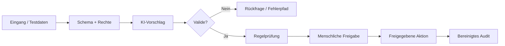

# KI-Toolbox · Was hinter den Namen steckt

**Stand: 23. November 2026** · Projektbasierte Einordnung, keine Anbieterpartnerschaft und keine Behauptung, dass alle Modelle als Live-API verfügbar sind.

Die Profil-README nennt bewusst mehr KI-Werkzeuge als früher. Entscheidend ist dabei die **Nachweisstufe**, nicht die Länge der Liste.

## Drei Nachweisstufen

| Stufe | Bedeutung | Was sie nicht bedeutet |
|:--|:--|:--|
| **A · Codebezug** | Ein konkretes Modul, ein SDK oder ein Client für einen Anbieter ist im Projektquellstand vorhanden | Dass der Client auf einem Produktivserver läuft oder eine E2E-Abnahme bestanden hat |
| **B · Projektwerkzeug** | Ein Tool wird in Projektmetadaten, Agentenregeln oder der Entwicklungsdokumentation als verwendetes Werkzeug geführt | Dass dieses Tool Teil der Endnutzer-Anwendung ist |
| **C · Planung / Experiment** | Modell, Anbieter oder Arbeitsweise kommt in Entwicklungsplänen, Aufgaben oder Konzepten vor | Dass eine fertige, eigenständige Integration existiert |

## KI-Dienste und Modelle

| Name (beschreibend) | Einordnung | Sachlicher Projektkontext |
|:--|:--|:--|
| **ChatGPT · OpenAI** | **B** | In Metadaten mehrerer privater Projektvorstellungen als Werkzeug für Konzeption und Entwicklungsarbeit dokumentiert |
| **Claude · Anthropic** | **B** | In Projektmetadaten, Arbeitsregeln und Entwickler-Anweisungen als unterstützendes Werkzeug dokumentiert |
| **DeepSeek** | **C** | In Aufgabenunterlagen und Designplänen als verwendeter bzw. angesprochener Entwickler-Workflow genannt; **kein hier nachgewiesener produktiver API-Client** |
| **Gemini · Google** | **A** | Modellkonfiguration und Gemini-Client-/Edge-Function-Code in privaten KI-/Produktprojekten vorhanden |
| **OpenAI API** | **B/C** | Erwähnungen in Architektur-/Prozessideen und Abhängigkeitskontexten; **keine pauschale Aussage** über produktive OpenAI-Anbindung |
| **LLM-basierte Systeme allgemein** | **A/B je nach Modul** | Strukturierte Ausgaben, Fallback-Ideen, KI-Gateways, Prompt- und Kostenkontrolle in verschiedenen Entwicklungsständen |

## Coding- und Agentenwerkzeuge

| Werkzeug | Einordnung | Wofür es in den Unterlagen steht |
|:--|:--|:--|
| **Codex** | **B** | Aufgaben, Implementierung, Reviews und Dokumentations-/Agentenstartpunkte |
| **GitHub Copilot** | **B** | Entwicklungsregeln, Arbeitsaufträge und projektbezogene Metadaten |
| **Cursor** | **B** | Editor- und Entwicklungsumgebung in Projektmetadaten; nicht mit gewöhnlichen Mauszeiger-Komponenten verwechseln |
| **Lovable** | **A/B** | Verbindungs-/Konfigurationsspuren und Entwicklungsstruktur in einzelnen Frontend-Projekten |
| **n8n** | **A/B** | Workflow-Orchestrierung im Projektumfeld; separates Showcase Studio zur lesenden Präsentation solcher Workflows |

**Wichtig:** Die privaten Quellstände sind absichtlich nicht öffentlich verlinkt. Die Einstufungen entstanden aus einer Prüfung der tatsächlich zugänglichen eigenen Projektdateien und sind **keine von Dritten reproduzierbaren Produktionszertifikate**.

## Wofür ich KI einsetze oder untersuche

### 1. Ideen und Systementwurf
Anforderungen strukturieren, Alternativen abwägen, Benutzerabläufe aufzeichnen, Risiken und Sonderfälle vor dem Coding sichtbar machen.

### 2. Implementierung und Prototyping
Kleine nachvollziehbare Änderungen vorbereiten, API-Verträge definieren, Fehlerzustände dokumentieren und UI-Varianten vergleichen. Ungeprüfte Modell-Ausgaben nicht automatisch übernehmen.

### 3. Daten und Automation
Texte klassifizieren oder strukturieren, nur wohlgeformte Schema-Daten weitergeben, deterministische Regeln nutzen und nötige Aktionen **erst nach expliziter Freigabe** ausführen.

### 4. Qualität und Dokumentation
Tests und Prüffragen entwerfen, Abweichungen erklären, Dokumentation aktualisieren – ohne aus einem vorgeschlagenen Test einen bestandenen Test zu machen.

## Was ich bewusst NICHT behaupte

- Kein generelles „alle Anbieter per API integriert“.
- Keine offiziellen Partner-, Zertifizierungs-, Community- oder Reseller-Beziehungen.
- Keine behaupteten Einsparungsquoten, Leistungswerte oder Millionen Nutzer.
- Keine Produktivfreigabe nur aufgrund vorhandener Module oder GitHub-Badges.
- Keine Verwendung von Anbieterlogos als eigene dekorative Tech-Marke.

## Beispiel für einen verantwortlichen KI-Workflow

Das Diagramm beschreibt ein **Entwurfsmuster**, keinen auf GitHub veröffentlichten und nachgewiesen laufenden Workflow. [Details zum Prozess](WORKFLOW_PLAYBOOK.md).

## Marken und Logos

Die genannten Produkte und Namen gehören ihren jeweiligen Inhabern. In der Profilgestaltung erscheinen sie als **schlicht gesetzte Textbezeichnungen ohne fremde Firmenlogos**. Das verhindert nicht jedes denkbare rechtliche Risiko, reduziert aber unnötige markenrechtliche Konflikte.

Relevante offizielle Regeln: [OpenAI Brand Guidelines](https://openai.com/brand/) · [Anthropic Legal / Trademark](https://www.anthropic.com/legal) · [DeepSeek Open Platform Terms](https://cdn.deepseek.com/policies/en-US/deepseek-open-platform-terms-of-service.html) · [DeepSeek Asset Guidelines](https://github.com/deepseek-ai/awesome-deepseek-integration/blob/main/docs/_logo%20svg/guidelines.md).

[Zurück zum Profil](../README.md) · [Markenpolitik](BRAND_POLICY.md)
