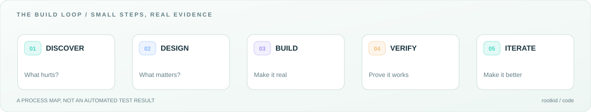

<div align="center">

[Deutsch](../README.md) · **English**

<picture><source media="(prefers-color-scheme: dark)" srcset="../assets/profile-hero-dark.svg" /></picture>

### Hey, I'm rootkid-code. 👋

# Build ideas. Understand systems. Make things better.

**AI · Automation · Product Engineering · UI/UX · Creative Web**

From an idea to a prototype — and, with careful tests and sensible design, to something people can actually use.

`⚡ VIBE CODING: ON` &nbsp; `🧪 REALITY CHECK: REQUIRED` &nbsp; `🚫 BLIND TRUST: OFF`

[Work](#selected-work) · [Stack](#technology-landscape) · [Build loop](#the-build-loop) · [Private lab](#inside-the-private-lab) · [Project notes](PROJECTS.en.md)

</div>

---

## 01 / The approach

**I don't start with the next trendy framework. I start with a problem worth solving.**

I work across AI-assisted automation, product interfaces, understandable processes and hands-on engineering. I enjoy rapid prototypes, but I care just as much about failure cases, data boundaries and how people experience the resulting product.

> **Build with curiosity. Ship with evidence.**

## 02 / Mission control

<picture><source media="(prefers-color-scheme: dark)" srcset="../assets/mission-control-dark.svg" /></picture>

<sub>Static, playful editorial art. Not live availability, measured progress or evidence of test completion. GitHub's native status is a separate account setting.</sub>

## 03 / Selected work

| Public project | What it explores | Availability |
|:--|:--|:--|
| [**Showcase Studio**](https://github.com/rootkid-code/showcase-studio-releases) | Local-first presentation and review of complex n8n workflows. | Public product information and documentation. **No public application download yet.** |
| [**Tresor / Beta Lab**](https://github.com/rootkid-code/tresor-releases) | Experimental Windows desktop architecture and release processes with Tauri, Rust and TypeScript. | Experimental betas only. **Disposable synthetic data, never important or sensitive files.** |

The repository links lead to genuinely public pages. Private code and unfinished release candidates are not offered as public downloads.

## 04 / Technology landscape

<picture><source media="(prefers-color-scheme: dark)" srcset="../assets/tech-landscape-dark.svg" /></picture>

<div align="center">
<p>
 &nbsp;
 &nbsp;
 &nbsp;
 &nbsp;
 &nbsp;
 &nbsp;
 &nbsp;

</p>
<sub>Self-hosted technology icon copies from an existing project. Third-party marks belong to their owners. No endorsement or official partnership is implied.</sub>
</div>

| Workstream | Technologies and ideas used or explored |
|:--|:--|
| AI & automation | n8n, LLM integration, Gemini, structured output, deterministic validation, human-in-the-loop |
| UI engineering | React, TypeScript, JavaScript, HTML/CSS, Vite, Astro, accessibility and design systems |
| Backend and data | Python, FastAPI, Node.js, PostgreSQL, Supabase, APIs and authentication |
| QA and delivery | GitHub, pull requests, Playwright, Vitest, explicit review and release gates |
| Creative development | Blender, Three.js, WebGL and interactive 3D prototypes |

No fake percentages, rankings or unverified certificates. [Technical source notes](TECH_STACK.md).

## 05 / The build loop

<picture><source media="(prefers-color-scheme: dark)" srcset="../assets/build-loop-en-dark.svg" /></picture>

1. **Discover:** Whose problem are we solving?
2. **Design:** What data, decisions and failure paths matter?
3. **Build:** How can we create a usable, testable prototype?
4. **Verify:** What has actually been checked?
5. **Iterate:** What becomes simpler, safer and more useful next?

[Engineering principles](BUILD_PRINCIPLES.en.md).

## 06 / Inside the private lab

These are private explorations and prototypes, **not publicly downloadable apps or production deployment claims**.

| Exploration | Domain |
|:--|:--|
| **Kettenwerk** | Bicycle workshop operations, AI-assisted intake, role-based workflow and human review |
| **KI-Atlas** | Linked AI glossary, educational UX and interactive knowledge maps |
| **SYNTHESIS** | Cinematic Blender-to-WebGL environments, 3D storytelling and performance |
| **Career Workspace** | Evidence-aware AI-assisted career/application workflows |
| **ProjectPilot** | Local coordination and quality-evidence workflow concept |

[More project context](PROJECTS.en.md).

## 07 / A tiny vibe-coding easter egg

<details><summary><strong>🖥️ Open the terminal — reality check incoming</strong></summary>

```text
rootkid@lab:~$ npm run vibe
  [██████████] curiosity          ON
  [██████████] ideas              READY

rootkid@lab:~$ npm run ship --skip-tests
  ERROR: confidence != evidence

rootkid@lab:~$ npm run ship --with-review
  ○ review requested
  ○ tests still need proof
  ○ docs under review

  Great vibes. Now bring receipts. 🧪
```

*Fictional terminal joke; not real build output or a passing test.*

</details>

## 08 / Right now

The priority is making existing software **clearer, better documented and better tested** — with reliable Free/Community experiments and useful public case studies.

**Sales, pricing and Pro commercialization are on HOLD.**

---

<div align="center">

### rootkid / code

*Vibe-code the sketch. Engineer the edge cases. Verify the release.*

[Public repositories](https://github.com/rootkid-code?tab=repositories) · [Project map](PROJECTS.en.md) · [Deutsch](../README.md)

<sub>No private personal information · No invented metrics · No visitor-tracking widgets</sub>

</div>
