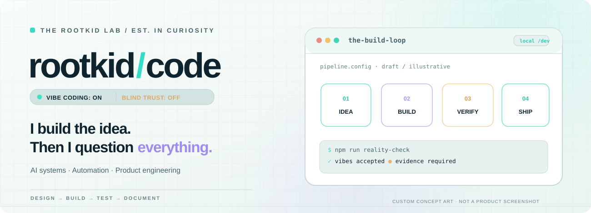
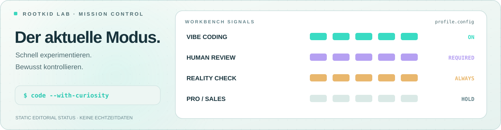
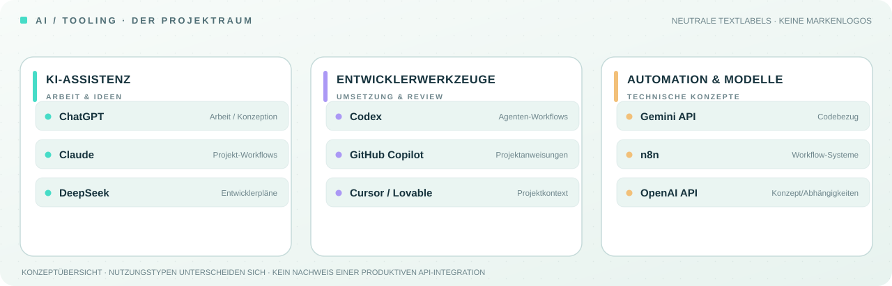
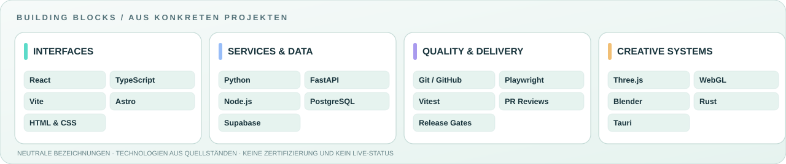
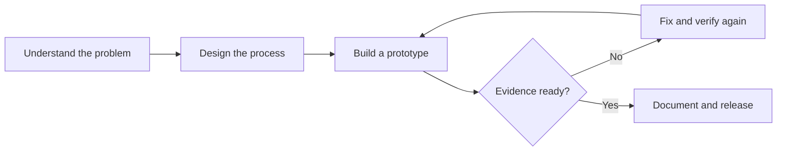

<div align="center">

[Deutsch](../README.md) · **English**

<picture>
  <source media="(prefers-color-scheme: dark)" srcset="../assets/profile-hero-dark.svg" />
  
</picture>

### Hey, I'm rootkid-code. 👋

# Turning ideas into systems. Keeping the reality check.

**AI & Automation · Product Engineering · UI/UX · Creative Development**

I build and explore digital tools — from first workflow and interface prototype to documented, verifiable engineering decisions.

`⚡ VIBE CODING: ON` · `🧪 REALITY CHECK: REQUIRED` · `🛡️ HUMAN REVIEW: ALWAYS`

[**Projects**](#03--public-projects) · [**AI workbench**](#04--the-ai-workbench) · [**Stack**](#05--technology-map) · [**Build loop**](#07--the-build-loop)

</div>

---

## 01 / Why I build

**The interesting part isn't the next framework. It's making a real process easier to understand and use.**

I work at the intersection of **AI-assisted automation, product interfaces, data flows, and practical engineering**. Rapid prototypes are fun; understanding permissions, failure cases, usability and test evidence is just as important.

> **Build with curiosity. Engineer the edges. Ship with evidence.**

This is a curated workbench, **not** a CV stuffed with unverifiable achievement badges or invented skill percentages.

## 02 / Mission Control

<picture>
  <source media="(prefers-color-scheme: dark)" srcset="../assets/mission-control-dark.svg" />
  
</picture>

<sub>Static editorial artwork, not live telemetry or verified test output. Native GitHub status and availability are separate account settings.</sub>

## 03 / Public projects

<table>
<tr>
<td width="50%" valign="top">
<div align="center">
  <picture>
    <source media="(prefers-color-scheme: dark)" srcset="https://raw.githubusercontent.com/rootkid-code/showcase-studio-releases/main/assets/brand/showcase-portfolio-dark.svg" />
    
  </picture>
  <h3><a href="https://github.com/rootkid-code/showcase-studio-releases">Showcase Studio</a></h3>
  <strong>Understand workflows. Present with care.</strong>
</div>
<p>Local-first n8n workflow presentation studio with seven visual styles, privacy review and offline exports. A public beta exists; it is not a stable product.</p>
<p><code>n8n</code> <code>Python</code> <code>FastAPI</code> <code>Workflow UX</code></p>
<p><strong>Status:</strong> <a href="https://github.com/rootkid-code/showcase-studio-releases/releases/tag/v1.0.0-beta.4"><strong>v1.0.0-beta.4 · public preview</strong></a> · Make/Zapier imports planned; visuals available as looks only</p>
<p><a href="https://github.com/rootkid-code/showcase-studio-releases"><strong>Explore project & docs →</strong></a></p>
</td>
<td width="50%" valign="top">
<div align="center">
  
  <h3><a href="https://github.com/rootkid-code/tresor-releases">Tresor / Beta Lab</a></h3>
  <strong>A hands-on desktop engineering lab.</strong>
</div>
<p>Experimental Windows project exploring local applications, packaging, update integrity, security boundaries and release engineering.</p>
<p><code>Rust</code> <code>Tauri</code> <code>React</code> <code>TypeScript</code></p>
<p><strong>Status: experimental beta packages.</strong> Never use real, sensitive or irreplaceable files.</p>
<p><a href="https://github.com/rootkid-code/tresor-releases"><strong>Explore Beta Lab →</strong></a></p>
</td>
</tr>
</table>

<sub>Both project graphics deliberately share the same 1440 × 600 aspect ratio. They are original concept artwork, not screenshots or test evidence.</sub>

## 04 / The AI workbench

Different AI tools play **different roles** in my project work: ideation, development, structured model output, orchestration and review.

<picture>
  <source media="(prefers-color-scheme: dark)" srcset="../assets/ai-workbench-dark.svg" />
  
</picture>

| Area | Examples | What the evidence means |
|:--|:--|:--|
| **AI assistants** | ChatGPT/OpenAI, Claude/Anthropic, DeepSeek | ChatGPT/Claude appear in private project metadata; DeepSeek in developer task documentation. **Not a claim of production API integration.** |
| **Coding workflows** | Codex, GitHub Copilot, Cursor, Lovable | Development instructions and project configuration references. |
| **Model/API code** | Gemini, n8n, structured outputs | Actual Gemini client/configuration code exists in private projects; n8n is a workflow domain in the project set. |
| **Guardrails** | JSON schemas, validation, human approval, QA | Engineering design principles and selected project implementations, not blanket certification. |

[**Detailed AI toolbox and evidence levels**](AI_TOOLBOX.en.md) · [**Workflow design playbook**](WORKFLOW_PLAYBOOK.md)

## 05 / Technology map

Instead of a wall of third-party company logos, the stack is grouped into **original neutral designs and readable descriptions**.

<picture>
  <source media="(prefers-color-scheme: dark)" srcset="../assets/stack-atlas-dark.svg" />
  
</picture>

| Domain | Tools explored in actual project contexts |
|:--|:--|
| Product interfaces | React, TypeScript, JavaScript, Vite, Astro, HTML/CSS, Tailwind |
| Backend & data | Python, FastAPI, Node.js, PostgreSQL, Supabase, API and auth models |
| Automation & AI | n8n, webhooks, LLMs, structured extraction, review workflows |
| QA & delivery | Git/GitHub, PR reviews, Playwright, Vitest, release evidence |
| Creative / desktop | Blender, Three.js, WebGL, Rust, Tauri |

These are **project technology references**, not certifications or proficiency percentages. [Stack provenance](TECH_STACK.md) · [Brand policy](BRAND_POLICY.md).

## 06 / Inside the private lab

The following are **private projects or concepts** at different maturity levels — not public downloads:

| Project | Idea | Focus |
|:--|:--|:--|
| **Kettenwerk** | Bicycle service intake, human-reviewed triage and connected workshop workflows | React, Supabase, Gemini |
| **KI-Atlas** | Connected AI glossary, visual knowledge exploration and learning paths | Astro, JavaScript |
| **SYNTHESIS** | Cinematic, monumental Blender-to-WebGL storytelling | Blender, Three.js, WebGL |
| **Career Workspace** | Evidence-aware AI-assisted application preparation | TypeScript, Supabase |
| **ProjectPilot** | Reviewable GitHub team coordination and QA evidence | GitHub workflows, process design |

[Project stories](PROJECT_STORIES.md) · [Public/private project map](PROJECTS.en.md)

## 07 / The build loop

<picture>
  <source media="(prefers-color-scheme: dark)" srcset="../assets/build-loop-en-dark.svg" />
  
</picture>



This is the engineering mindset I aim for, **not a claim that all of my projects have passed every stage**.

[Build principles](BUILD_PRINCIPLES.en.md) · [Automation playbook](WORKFLOW_PLAYBOOK.md)

## 08 / The tiny vibe-coding terminal

<details>
<summary><strong>⚡ Open the terminal (fictional, obviously)</strong></summary>

```text
rootkid@lab:~$ vibe --intensity=11
  [██████████] curiosity     ON
  [██████████] ideas         READY

rootkid@lab:~$ ship --skip-review
  ✖ ERROR: confidence != evidence
  Hint: tests, documentation and privacy review are not optional.

rootkid@lab:~$ ship --with-receipts
  ◇ review requested
  ◇ tests still need proof
  ◇ docs under review

  Immaculate vibes. Unimpressed release gate. 🧪
```

*Fictional terminal joke. No real CI, no passed test, no product availability claim.*

</details>

## 09 / Read more

| Topic | Detail |
|:--|:--|
| [AI Toolbox](AI_TOOLBOX.en.md) | Providers, coding tools, model integrations, evidence levels |
| [Tech stack](TECH_STACK.md) | Actual project technology context |
| [Project stories](PROJECT_STORIES.md) | Problems, approaches, limitations and status |
| [Workflow playbook](WORKFLOW_PLAYBOOK.md) | Validation, human review, errors and privacy |
| [Brand usage](BRAND_POLICY.md) | Why third-party logos aren't used for decoration |
| [Brand system](BRAND_GUIDE.md) | Original artwork, theme colors and logo handoff |

**Current priority:** clearer UX, safer workflows, reliable Free/Community experiments and transparent project documentation. **Sales, pricing and Pro commercialization are on HOLD.** Showcase Studio has a public **Beta 4** for testing, not a stable production approval.

---

<div align="center">

### rootkid / code

*Vibe-code the idea. Engineer the edges. Show the evidence.*

[Public repositories](https://github.com/rootkid-code?tab=repositories) · [Deutsch](../README.md) · [Legal](../NOTICE.md)

<sub>Independent portfolio · No vendor partnerships implied · No tracking widgets · No fake statistics</sub>

</div>
