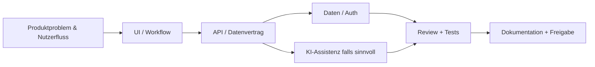

# Technologie-Landkarte · Quellstand statt Logo-Liste

**Stand 23.11.2026.** Diese Seite erklärt, welche Technologien in konkreten Projektständen vorkommen. Sie ist **keine Skill-Rangliste**, kein Nachweis für Berufserfahrung bei Herstellern und kein Testbericht.

## Warum die Darstellung jetzt anders aussieht

Die Profilseite verwendet ab sofort **eigene, neutrale SVG-Karten und klaren Text**. Die acht früher importierten Fremdlogos wurden aus dem aktuellen Git-Baum entfernt. Der Name eines Werkzeugs ist nötig, um eine Technologie nachvollziehbar zu beschreiben; sein offizielles Markenlogo ist dafür nicht nötig.

Eigene Grafiken: [AI Workbench Dark](../assets/ai-workbench-dark.svg) · [AI Workbench Light](../assets/ai-workbench-light.svg) · [Stack Atlas Dark](../assets/stack-atlas-dark.svg) · [Stack Atlas Light](../assets/stack-atlas-light.svg).

## Die Systemebenen

| Ebene | Technologien / Methoden | Nachvollziehbarer Projektkontext |
|:--|:--|:--|
| **Interface & Produkt** | React, TypeScript, JavaScript, HTML, CSS, Tailwind CSS, Vite | Portfolio, Kettenwerk, Career Workspace |
| **Inhalts-/Lernsysteme** | Astro, Content-Modelle, Markdown/JSON, Wissensgraph | KI-Atlas |
| **Server & APIs** | Python, FastAPI, Node.js, HTTP-Endpunkte, API-Verträge | Showcase Studio, verschiedene Service-Prototypen |
| **Daten & Berechtigungen** | PostgreSQL, Supabase, Authentifizierung, Rollen, RLS | Kettenwerk, Career Workspace, KI-Atlas |
| **AI/Automations-Code** | Gemini API, n8n, Modellkonfiguration, strukturierte Ausgaben | Mealio, Showcase Studio, andere Projektkontexte |
| **AI/Coding-Werkzeuge** | ChatGPT, Claude, DeepSeek, Codex, GitHub Copilot, Cursor, Lovable | Projektmetadaten, Agentenregeln, Planungs-/Entwicklerunterlagen; **unterschiedliche Nachweisstufen** |
| **Test & Review** | Git, GitHub PRs, Vitest, Playwright, dokumentierte QA-Gates | Portfolio, Career Workspace, Release-/Review-Unterlagen |
| **3D & Creative Tech** | Blender, Three.js, WebGL, glTF, Kamerafahrten | SYNTHESIS |
| **Desktop & Packaging** | Rust, Tauri, lokale Windows-Anwendungen und Paketierung | Tresor-Beta-Lab |

**Konkrete technische Nachweise (intern):** `Ai-pedia/package.json` zeigt Astro; `portfolio/package.json` zeigt React, Vite und Playwright; `pixel-perfect/package.json` dokumentiert Vitest/TypeScript; `show_case/studio/requirements.txt` listet FastAPI; `Mealio/supabase/functions/_shared/gemini-client.ts` enthält Gemini-Client-Code. Diese Quellstände sind **privat** und deshalb absichtlich nicht als für Besucher erreichbare GitHub-Links dargestellt.

Die Nennung einer Programmiersprache oder Library bedeutet nicht, dass ich in jedem Bereich denselben Erfahrungsgrad habe. **Ein Quellfile ist kein Beleg für Produktivbetrieb.**

## Was die Kategorien praktisch verbinden kann

Ein bewusst **generisches Architekturmodell**: Es bildet nicht exakt die gesamte Runtime eines konkreten Projekts ab.

## KI-Anbieter genauer

ChatGPT, Claude, DeepSeek, Gemini, Codex, Cursor, Copilot und Lovable sind **keine austauschbaren technischen Kategorien**. Einige sind Assistenz- und Coding-Werkzeuge, andere Modelle, APIs oder Entwicklungsplattformen.

Die genaue, überprüfte Einordnung steht in der [AI Toolbox](AI_TOOLBOX.md).

## Marken- und Sicherheitsgrenzen

- Fremdmarken werden sachlich **als Text** benannt; die grafischen Kacheln reproduzieren keine Herstellerlogos.
- Es werden **keine** offiziellen Integrator-, Partner-, Sponsor- oder Zertifizierungsbeziehungen behauptet.
- Keine Bilder direkt von fremden Asset-CDNs einbetten; keine Besuchertracker.
- Keine privaten Repositorys, persönlichen Daten oder produktiven Zugangsschlüssel offenlegen.
- Aktuelle öffentliche Produktdateien und die tatsächlichen Release-Hinweise sind die Quelle für Produktverfügbarkeit.

[← Profil](../README.md) · [Markenpolitik](BRAND_POLICY.md) · [AI Toolbox](AI_TOOLBOX.md)
