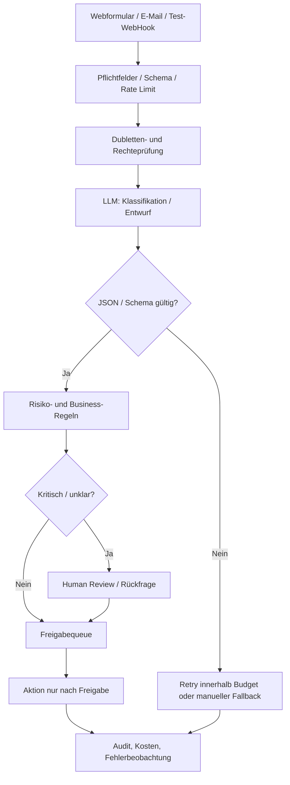

# Automation- und AI-Workflow-Playbook

> **Fachliche Arbeitsweise und mögliche Referenzarchitektur.** Kein Nachweis eines weltweit eingesetzten, unbeaufsichtigten KI-Systems und keine Release-Zertifizierung.

## Das Grundprinzip

**KI generiert Vorschläge. Regeln kontrollieren Zustände. Menschen geben kritische Entscheidungen frei.**

### Warum diese Trennung?

- **Eingabeprüfung:** Fehlende Daten vor einem Modellaufruf erkennen und unnötige API-Kosten vermeiden.
- **Deterministische Regeln:** Kritische Entscheidungen nicht allein aus Modelltext ableiten.
- **Strukturierte Ausgaben:** JSON-Schema beziehungsweise typisierte Verträge statt unkontrollierter Freitextverarbeitung.
- **Kontrollierte Veröffentlichung:** E-Mails, Preise, Tickets oder Zugriffsänderungen nicht stillschweigend versenden.
- **Betriebsbeobachtung:** Kosten, Token, Fehlerraten, Retries, Benutzerfreigaben und Ausnahmefälle dokumentieren, ohne personenbezogene Rohdaten zu sammeln.

## Beispielhafte Fehlerpfade

| Situation | Erwartetes Verhalten |
|:--|:--|
| Ungültige oder unvollständige Eingabe | Gezielte Rückfrage, kein unnötiger Modellaufruf |
| API-Timeout / Limit erreicht | Begrenzt erneut versuchen oder sauber in manuellen Prozess wechseln |
| Ungültige Modell-Ausgabe | Verwerfen, schema-geprüft wiederholen oder human review |
| Unsichere / rechtlich sensible Anfrage | Eskalieren, keine automatische Sachentscheidung |
| Doppelte Anfrage | Idempotenz-/Dublettenprüfung, keine doppelten Aktionen |
| Externe Integration nicht erreichbar | Fehlermeldung, Retry Queue und nachvollziehbarer Status |
| Sensible Felder im Log | Maskierung/Minimierung; keine API-Keys oder vollständigen Daten im öffentlichen Report |

## Kosten und Qualität

Wenn später reale Daten vorliegen, können Kennzahlen wie **Durchlaufzeit, manuelle Bearbeitungszeit, Modellkosten, Fehlerrate und Freigabequote** betrachtet werden. Ohne erhobene Messwerte werden hier **keine konkreten Einsparungen oder Prozentzahlen behauptet**.

## Technologien und Verantwortung

n8n, Python, APIs, Supabase/PostgreSQL und verschiedene KI-Dienste erscheinen je nach Produktprojekt als Bausteine. Ihre **tatsächlich installierte Kombination** hängt vom einzelnen Quellstand ab; eine README ist keine Architekturabnahme.

[KI-Toolbox](AI_TOOLBOX.md) · [Arbeitsprinzipien](BUILD_PRINCIPLES.md) · [Profil](../README.md)
